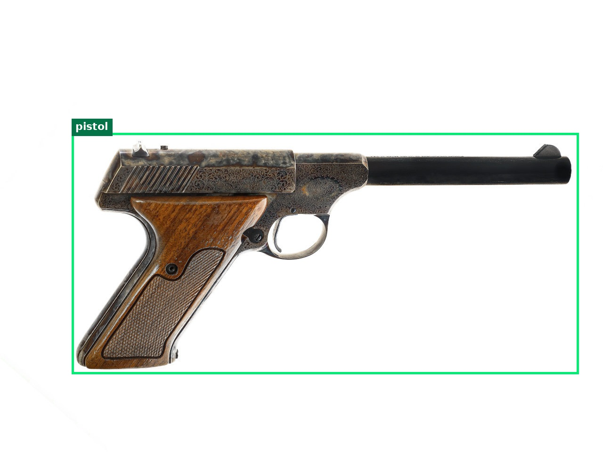
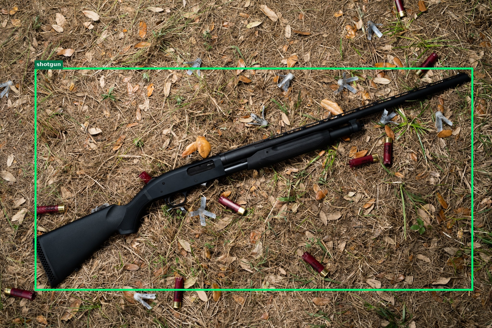

# Multi-class YOLO Annotation Portfolio — Proposed Relabeling

**Helia Salimi** — Computer Vision Annotation Samples

This portfolio demonstrates three image–label pairs with class IDs adjusted for a proposed three-class taxonomy:

| ID | Class |
|---:|---|
| 0 | `pistol` |
| 1 | `rifle` |
| 2 | `shotgun` |

## Samples

| Image | Label | Preview |
|---|---|---|
| `semi_auto_pistol_7.jpg` | Class 0 — pistol |  |
| `semi_auto_pistol_10.jpg` | Class 0 — pistol |  |
| `shotgun_12.jpg` | Class 2 — shotgun |  |

Each YOLO label line uses `class_id center_x center_y width height` with normalized coordinates. This set contains **no rifle example**; class 1 is reserved for rifle images.

## Important distinction

The class IDs in this portfolio were **reassigned for demonstration** from the supplied single-class labels. This is **not evidence that the original YOLOv7 model was trained for three-class classification**. To train a true three-class model, review and consistently relabel the full dataset, update dataset configuration, and retrain/validate the model.

These previews show manual bounding-box labels, not detection inference.

## QA

The shotgun box includes some unnecessary background and should be tightened before presenting this as a production-quality annotation sample.

## Image rights

Confirm redistribution rights for the source photographs before publishing this portfolio publicly. Annotation ownership and image copyright can differ.
