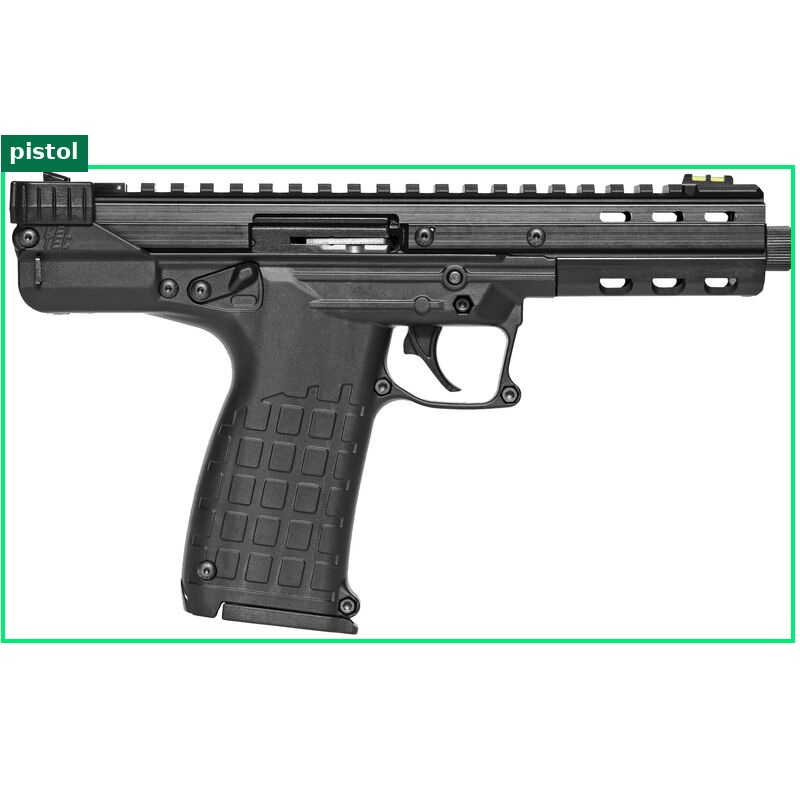

Computer Vision Annotation Portfolio
Helia Salimi  
M.Sc. Student in Artificial Intelligence and Robotics | Shiraz University
Focus: Image Annotation · Computer Vision · YOLOv7 · Dataset Preparation · Python · PyTorch · OpenCV
Overview
This repository showcases selected image-annotation examples from my object-detection project. It contains paired images and YOLO-format labels, plus visualizations of the bounding boxes.
The wider project covered five weapon categories: Pistol, Rifle, Shotgun, Revolver, and Machine Gun. Their original numeric class-ID order has not yet been verified.
Annotation Samples
Pistol — clean background (sample 7)

Original image · YOLO label
Pistol — clean background (sample 10)

Original image · YOLO label
Shotgun — complex background (sample 12)

Original image · YOLO label
QA note: The third bounding box includes some extra background and would benefit from a tighter review.
Annotation Format
YOLO annotation files store one line per object:
```text
class_id center_x center_y width height
```
Spatial values are normalized to the interval [0, 1].
Important Note on Class IDs
The uploaded source sample labels originally used class ID `0` for every object. For the current portfolio, a provisional three-class demonstration mapping was used: pistol = 0, rifle = 1, shotgun = 2. Thus the displayed shotgun sample has been provisionally changed to class 2. These are not verified IDs from the original five-class dataset.
The repository's current `classes.txt` and `data.yaml` still describe the provisional three-class example. They should not be used as the original model's training configuration. The portfolio does not establish that a five-class YOLOv7 model was trained or validated.
Relevant Skills
Image annotation and YOLO-format dataset preparation
Bounding-box inspection and annotation quality review
LabelImg, Python, PyTorch, OpenCV and YOLOv7
Repository Structure
```text
images/       Sample images
labels/       Matching YOLO annotations
previews/     Bounding-box visualizations
classes.txt   Provisional three-class labels
data.yaml     Provisional three-class configuration
README.md     Project documentation
```
Attribution
This portfolio documents my annotation work. YOLOv7 is a third-party framework, and I do not claim authorship of its original code. Source-image publication remains subject to applicable rights and permissions.
